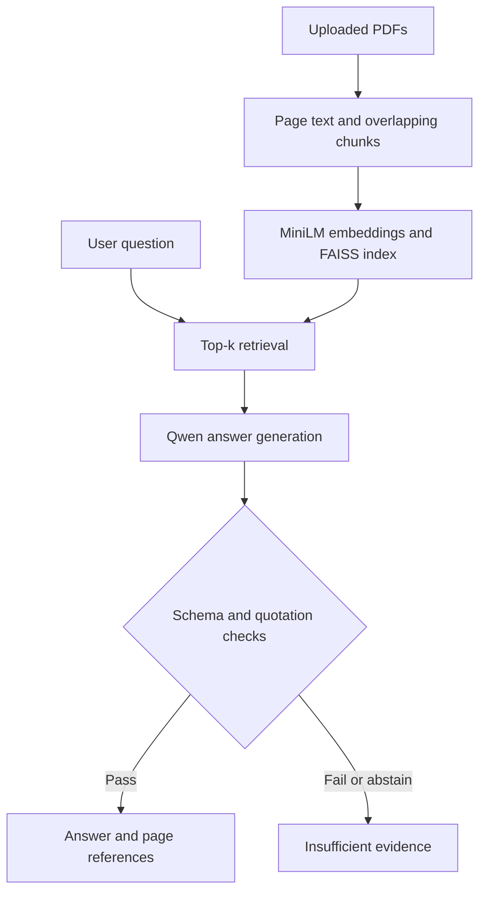

# PDF RAG Research Assistant

A Google Colab notebook that answers questions about uploaded PDFs using semantic retrieval and a local open-weight language model. Answers include source filenames, PDF page positions, and supporting quotations that are checked against retrieved text.

**Author:** Manodip Bouri  
**Status:** Notebook prototype; no hosted application or published benchmark results.

## Overview

Reading long research documents to locate specific evidence can be time-consuming. This project extracts text from PDFs, divides each page into overlapping passages, retrieves relevant passages with FAISS, and supplies them to Qwen for question answering.

The model is prompted to use only the retrieved evidence. Invalid output, missing citations, and quotations that do not occur in the supplied evidence cause the pipeline to return an insufficient-evidence response. These checks do not prove that an answer is factually correct or supported by its quotations.

## Implemented features

- Upload one or more text-based PDFs through Google Colab.
- Extract page-level text with pypdf and report pages without extractable text.
- Create overlapping chunks with stable IDs based on file content and page offsets.
- Embed passages with Sentence Transformers.
- Retrieve similar passages using an in-memory FAISS index.
- Generate structured JSON answers with Qwen2.5-1.5B-Instruct.
- Validate citation source IDs and normalized quotation matches.
- Display source filenames, page positions, quotations, and answer status.
- Inspect retrieved passages and similarity scores.
- Evaluate manually supplied question/answer pairs with normalized exact match and token F1.
- Inspect in-memory question, status, latency, and retrieval-count traces.
- Save and restore a FAISS index and extracted document metadata.

## Architecture



## Technology stack

| Component | Technology |
| --- | --- |
| Environment | Python and Google Colab |
| Text extraction | pypdf |
| Embeddings | sentence-transformers/all-MiniLM-L6-v2 |
| Vector search | FAISS IndexFlatIP |
| Generation | Qwen/Qwen2.5-1.5B-Instruct |
| Model runtime | Hugging Face Transformers, PyTorch, Accelerate |
| Tabular inspection | pandas |

Normalized embeddings make FAISS inner products equivalent to cosine similarity. A similarity score is a retrieval score, not an answer-confidence probability.

## Repository files

| File | Purpose |
| --- | --- |
| `PDF_RAG_AI_Assistant.ipynb` | Main Colab notebook; saved outputs cleared |
| `requirements.txt` | Direct Python dependencies; not an exact environment lock |
| `.gitignore` | Excludes PDFs, extracted text, indexes, credentials, and model files from Git staging |
| `GITHUB_SETUP.md` | Publishing instructions and repository metadata |
| `README.md` | Project documentation |

## Run in Google Colab

1. Open [Google Colab](https://colab.research.google.com/).
2. Upload `PDF_RAG_AI_Assistant.ipynb` through the notebook-open dialog.
3. Select a GPU runtime if available. CPU fallback exists but generation will be slower.
4. Run Cells 1–5 to install dependencies and initialize PDF extraction, embeddings, and an empty vector store.
5. Run Cell 6 and upload one or more PDFs. Cell 7 previews indexed chunk metadata.
6. Run Cells 8–10 to load Qwen and define generation and question answering.
7. Run Cell 11 and type your question. Rerun Cell 11 for additional questions.
8. Optionally use Cell 12 to inspect retrieved passages, Cell 13 for evaluation, and Cell 16 for traces.

Cell numbers above count the notebook's original 16 code cells from 1. The notebook uses `google.colab.files`, so it is not a drop-in local Jupyter or Streamlit application.

The first run downloads pretrained model weights and requires internet access. No paid inference API key is required. No model training or fine-tuning is performed.

### Example questions

- What is the main objective of this study?
- Which materials were used to prepare the hydrogel?
- What experimental conditions are reported?
- What limitations do the authors describe?

Choose questions that your uploaded document actually answers. These are example prompts, not measured results. Broad summaries may need information beyond the retrieved top five chunks.

## Configuration

Edit these constants in Cell 2 before creating the index:

| Setting | Default | Purpose |
| --- | --- | --- |
| `CHUNK_WORDS` | 180 | Words per chunk |
| `OVERLAP_WORDS` | 40 | Overlap between consecutive chunks on a page |
| `TOP_K` | 5 | Retrieved passages per question |
| `MAX_EVIDENCE_CHARS` | 1400 | Maximum characters passed from each passage |
| `EMBEDDING_MODEL` | all-MiniLM-L6-v2 | Passage and query encoder |
| `LLM_MODEL` | Qwen2.5-1.5B-Instruct | Answer generator |

Recreate the vector store and re-upload PDFs after changing the embedding model or chunk settings. Rerun dependent function-definition cells after changing settings used as default arguments. Prompt inputs longer than 6,000 tokens are rejected by the generation helper.

## Evaluation

Cell 13 includes a template for manually labeled PDF questions:

```python
test_cases = [
    {
        "question": "What is the main objective of the study?",
        "expected_answer": "Replace this with the verified answer from your PDF."
    }
]
```

Fill the expected answers after checking the documents, then run the evaluation cell.

- **Normalized exact match:** whether normalized predicted and expected strings match.
- **Token F1:** overlap between normalized predicted and expected answer tokens.
- **Answer status:** whether the response passed quotation checks, abstained, or failed validation.

No populated evaluation set or aggregate accuracy result is included. Exact match and token F1 are limited for long, paraphrased answers. Manually review whether each citation supports its associated claim and test unanswerable questions as well.

The current notebook does not use HotpotQA. HotpotQA benchmarking would be a separate addition with its own corpus and evaluation protocol.

## Saving and restoring an index

Cell 14 writes `index.faiss` and `documents.json` under `/content/pdf_rag_index`. These files remain in the temporary Colab runtime unless you separately copy them to private persistent storage.

To restore in a fresh runtime:

1. Run Cells 1–5.
2. Restore both saved files to `/content/pdf_rag_index`.
3. Define `OUTPUT_DIR = Path("/content/pdf_rag_index")` in a new cell.
4. Run Cell 15 to load the saved data; do not run Cell 14 first, because it saves the current store and could overwrite the restored files.
5. Run Cells 8–10, then Cell 11 to ask a question.

Only load trusted index files. Use the same embedding model and configuration used to build the index. The restore cell checks vector dimensions and document counts; these checks cannot establish embedding-model identity.

## Limitations

- Scanned image-only pages require an external OCR step.
- Tables, equations, columns, and layouts may not extract reliably.
- Retrieval can omit relevant information; the model only sees retrieved excerpts.
- Small-model reasoning and JSON formatting can fail.
- Verified quotations do not establish semantic entailment or factual correctness.
- This is single-pass RAG, not an autonomous agent with tool planning.
- There is no Streamlit UI, authentication, multi-user access control, or production deployment in this notebook.
- Indexes and traces are runtime-local unless explicitly saved. Questions are included in traces; the no-document return path is not traced.
- Dependency ranges are not a reproducible lockfile, and the supplied package was not verified with a full GPU inference run.

## Data handling

PDFs and model inference run in the Colab runtime, which is a hosted environment. The notebook does not call a paid remote text-generation API. Extracted text is saved in `documents.json`, and traces contain user questions. Keep private PDFs, extracted text, and saved notebook outputs out of public repositories. `.gitignore` does not remove files already committed and does not sanitize notebook outputs.

## Planned improvements

- Streamlit PDF upload and question-answering interface.
- OCR for scanned documents.
- Hybrid keyword/vector retrieval and reranking.
- A curated evaluation set and measured retrieval and answer results.
- Semantic grounding checks beyond quotation matching.
- Authenticated document access and model-aware index metadata.
- A bounded multi-step agent workflow for questions needing additional searches.

## References

- [Sentence Transformers model](https://huggingface.co/sentence-transformers/all-MiniLM-L6-v2)
- [Qwen model](https://huggingface.co/Qwen/Qwen2.5-1.5B-Instruct)
- [FAISS](https://github.com/facebookresearch/faiss)
- [pypdf documentation](https://pypdf.readthedocs.io/)

